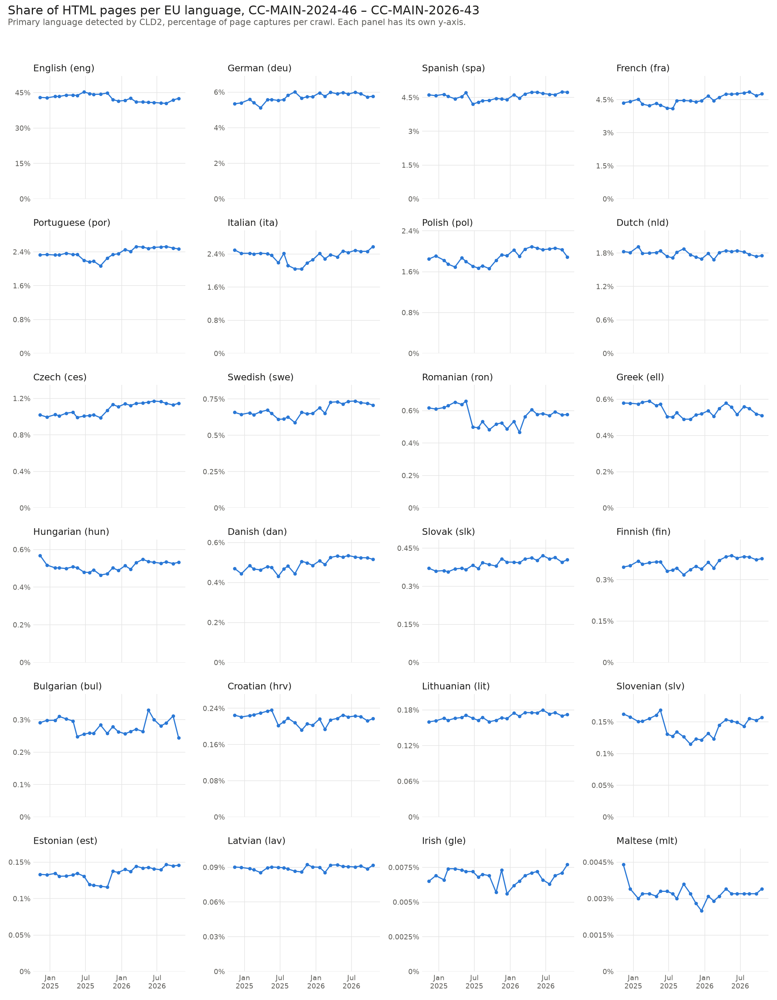
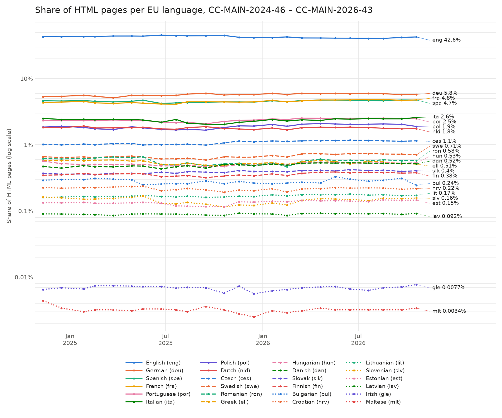

Evolution of EU Languages
=========================

The plots show how the share of the 24 official languages of the European Union changed over the monthly crawls of the last two years. Like on the [languages page](../languages.md), the language of a document is the primary language identified by [Compact Language Detector 2 (CLD2)](https://github.com/CLD2Owners/cld2), and the share is the percentage of HTML pages in a crawl.

Each panel of the first plot has its own y-axis, starting at zero, so that the trend of each language is visible regardless of its share.

The second plot shows all 24 languages on a logarithmic scale, to compare the languages with each other. Each line is labelled with the language code and its share in the latest crawl.

The underlying data is provided in the table below (languages ordered by average share) and as CSV ([eu-languages-share.csv](./eu-languages-share.csv)).
